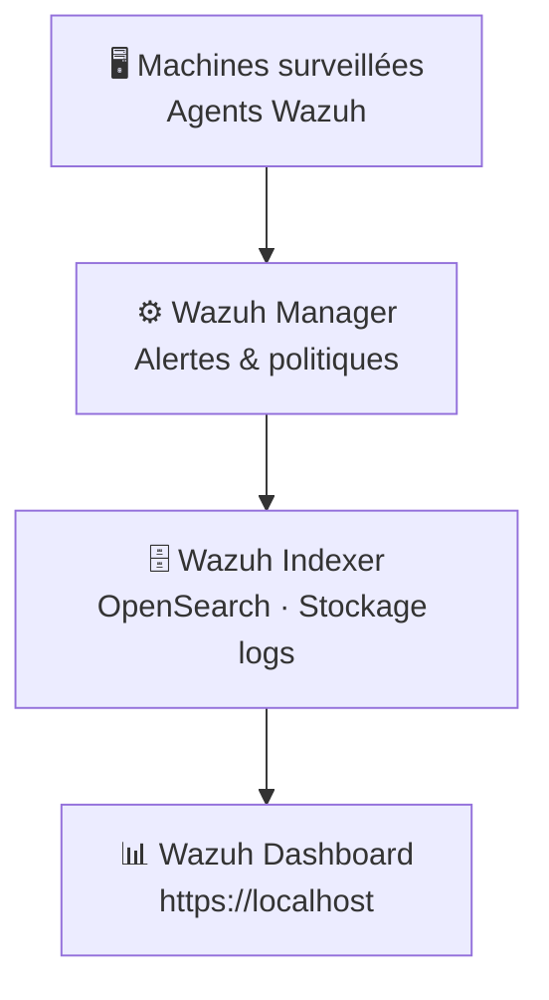

# My-Home-SOC — Lab de supervision Wazuh / OpenSearch

Infrastructure SOC domestique pour centraliser les logs, détecter les anomalies
et s'entraîner à l'investigation d'incidents.  
Stack : Wazuh (Indexer, Manager, Dashboard) conteneurisée via Docker / WSL 2.

---

## Architecture



---

## Déploiement

**Prérequis WSL 2** — configuration mémoire pour les services Java :

```bash
wsl -d docker-desktop -u root sysctl -w vm.max_map_count=262144
```

**Lancement (version 4.7.1) :**

```bash
docker-compose up -d
docker ps   # doit afficher 3 conteneurs "Up"
```

**Si le Dashboard affiche "Not ready yet" :**

```bash
docker exec -it wazuh.indexer bash \
  /usr/share/wazuh-indexer/plugins/opensearch-security/tools/securityadmin.sh \
  -cd /usr/share/wazuh-indexer/plugins/opensearch-security/securityconfig/ \
  -icl -nhnv \
  -cacert /usr/share/wazuh-indexer/certs/root-ca.pem \
  -cert /usr/share/wazuh-indexer/certs/admin.pem \
  -key /usr/share/wazuh-indexer/certs/admin-key.pem \
  -h localhost
```

Interface : `https://localhost` — identifiants : voir la [documentation officielle Wazuh](https://documentation.wazuh.com)

---

## Incident résolu — DNS interne

**Symptôme :** le Dashboard ne joignait pas l'Indexer.

**Cause :** le Dashboard cherchait `wazuh.indexer` alors que Docker créait `wazuh-indexer`.

**Fix :** forçage de `container_name` et mise à jour de `INDEXER_URL` dans `docker-compose.yml`.

---

## Résultats

- 3 règles de détection personnalisées (brute-force SSH, scan de ports, connexion hors plage horaire)
- Alertes corrélées et qualifiées quotidiennement
- Incident DNS diagnostiqué et résolu par analyse des logs applicatifs

---

## Limites

- Lab isolé — aucun agent sur des machines de production
- Pas de SOAR connecté — réponse aux incidents manuelle
- Single node — pas de haute disponibilité
- Volume de logs limité à l'environnement local
